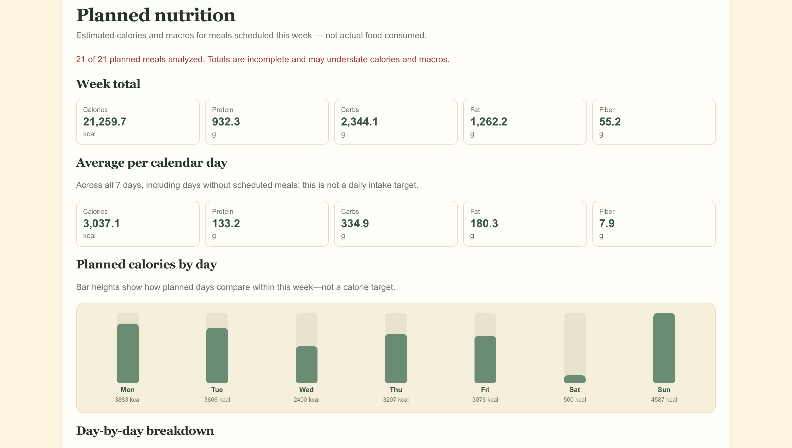
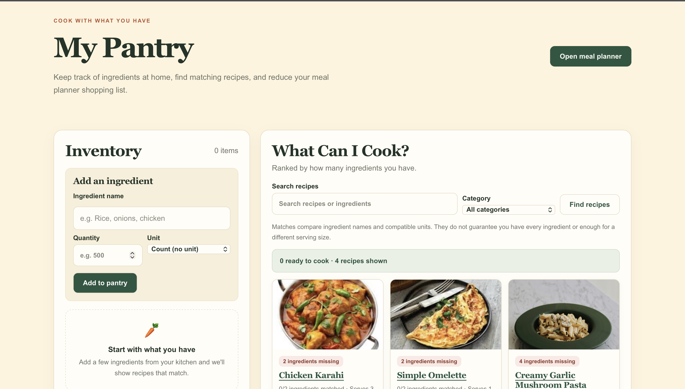
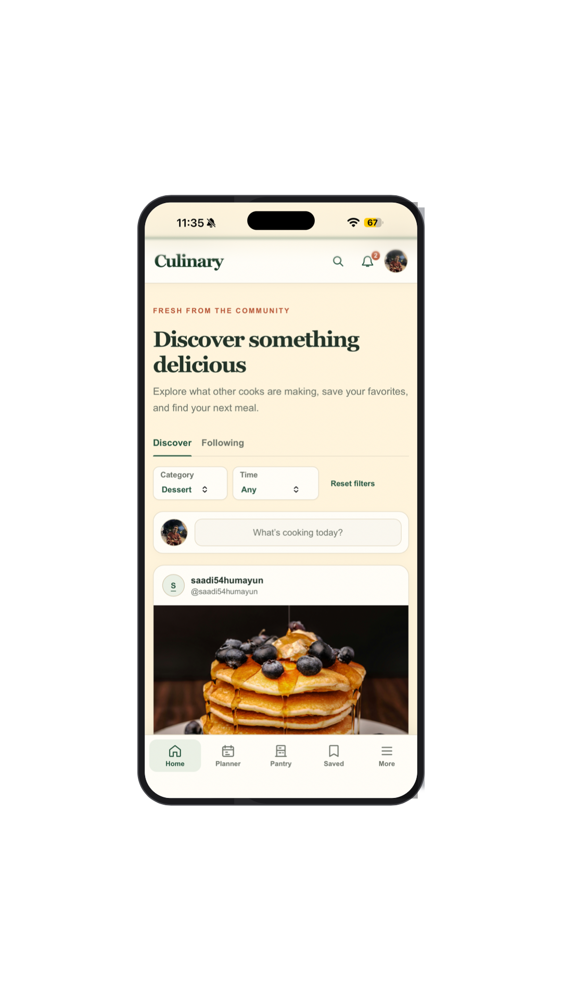

<div align="center">

# 🍳 Culinary

### Discover recipes. Plan your week. Cook with confidence.

**A full-stack recipe-sharing and meal-planning platform with social features, nutrition estimates, smart pantry tools, AI assistance, and an installable offline-capable PWA.**

[**Live App**](https://culinary-1jfq.vercel.app/) · [**Source Code**](https://github.com/saadi54humayun/culinary) · [**Report an Issue**](https://github.com/saadi54humayun/culinary/issues)


</div>

---

## Overview

**Culinary** brings recipe discovery, community interaction, and practical cooking tools together in one place. Users can publish recipes, connect with other cooks, organize their weekly meals, calculate shopping needs, and follow guided cooking instructions, even when their internet connection is unavailable for previously downloaded recipes.

The application is built as a **React/Vite frontend** backed by a **Node.js/Express REST API**, with **MongoDB Atlas** for persistent data. Its frontend and backend are deployed as separate Vercel projects.

## Screenshots

| Weekly meal planner | Smart pantry |
| :---: | :---: |
|  |  |

<p align="center"><strong>Installable mobile PWA</strong></p>
<p align="center"></p>

## Key Features

| Area | Capabilities |
| --- | --- |
| **Accounts & profiles** | Signup, email OTP verification, login, password recovery, user profiles, and authenticated sessions |
| **Recipe publishing** | Create, edit, publish, and manage recipe drafts; upload recipe photos |
| **Community** | Discover and Following feeds, likes, comments, user search, follows, and notifications |
| **Personal cookbook** | Save recipes to revisit later and download selected published recipes for offline use |
| **Meal planning** | Plan breakfast, lunch, and dinner for the week; search published recipes; adjust servings |
| **Smart groceries** | Automatically aggregate recipe ingredients, subtract pantry inventory where units are compatible, and export grocery lists as PDFs |
| **Smart pantry** | Track ingredients and quantities; discover recipes using ingredients already available |
| **Nutrition insights** | Estimate calories, protein, carbohydrates, fat, and fiber using USDA FoodData Central; view planned daily and weekly totals |
| **Cooking Mode** | Step-by-step instructions, ingredient checklist, scaled quantities, cooking timers, and resumable progress |
| **AI assistance** | Gemini-powered cooking chatbot and AI-assisted meal-plan suggestions using published Culinary recipes |
| **PWA & offline cooking** | Home Screen installation, downloaded recipes, offline cooking progress, and synchronization on reconnect |

> **Note:** Nutrition values are estimates and planned totals are not records of food consumed. AI responses and ingredient matching may be incomplete; always verify ingredients, allergens, and food safety.

## Tech Stack

| Layer | Technologies |
| --- | --- |
| Frontend | React 19, Vite, React Router, CSS |
| Backend | Node.js 22, Express 5, REST API |
| Database | MongoDB Atlas, Mongoose |
| Authentication | `express-session`, `connect-mongo`, Argon2, email OTP |
| Images | Cloudinary, Multer |
| AI | Google Gemini API |
| Nutrition | USDA FoodData Central API |
| Email | Nodemailer with SMTP |
| Offline support | PWA manifest, service worker, IndexedDB |
| Deployment | Vercel (frontend and backend), MongoDB Atlas |


## Project Structure

```text
culinary/
├── backend/
│   ├── config/          # Database and session configuration
│   ├── controllers/     # Request handlers
│   ├── middlewares/     # Authentication and request handling
│   ├── models/          # Mongoose schemas
│   ├── routes/          # Express API routes
│   ├── services/        # Integrations and business logic
│   ├── tests/           # Backend tests
│   ├── .env.example     # Safe environment-variable template
│   └── index.js         # Express entry point
├── frontend/
│   ├── public/          # PWA icons and manifest
│   ├── scripts/         # Service-worker build tooling
│   ├── src/
│   │   ├── components/  # Reusable UI components
│   │   ├── offline/     # Device storage and progress sync
│   │   └── pages/       # Application screens
│   └── vite.config.js
├── docs/
│   └── screenshots/
└── README.md
```

## Run Locally

### Prerequisites

- **Node.js 22** and npm
- A **MongoDB Atlas** database and connection string
- Cloudinary credentials for image uploads
- An SMTP provider for real signup verification and password recovery
- Optional: Gemini and USDA API keys for their respective features

### 1. Clone the repository

```bash
git clone https://github.com/saadi54humayun/culinary.git
cd culinary
```

### 2. Configure the backend

```bash
cd backend
npm ci
cp .env.example .env
```

Edit `backend/.env` with your own values. The key settings are:

| Environment variable | Purpose |
| --- | --- |
| `PORT` | Set to `5001` for local development (matches Vite's API proxy) |
| `MONGODB_URI` | MongoDB Atlas connection string |
| `SESSION_SECRET` | Strong secret for session signing |
| `OTP_SECRET` | Separate strong secret for email verification |
| `CLOUDINARY_CLOUD_NAME`, `CLOUDINARY_API_KEY`, `CLOUDINARY_API_SECRET` | Image storage |
| `MAIL_MODE`, `SMTP_HOST`, `SMTP_PORT`, `SMTP_SECURE`, `SMTP_USER`, `SMTP_PASS`, `MAIL_FROM` | Verification and password-reset email |
| `GEMINI_API_KEY`, `GEMINI_MODEL`, `GEMINI_TIMEOUT_MS` | Optional AI features |
| `USDA_API` | Optional nutrition analysis |

For SMTP over port **465**, set `SMTP_SECURE=true`; for STARTTLS over **587**, use `SMTP_SECURE=false`. `MAIL_MODE=preview` is for limited local UI testing and **does not send verification emails**.

**Never commit real `.env` files, API keys, or database credentials.**

### 3. Start the backend

```bash
# In backend/
npm start
```

The API runs at `http://localhost:5001` when `PORT=5001`.

### 4. Start the frontend

In another terminal:

```bash
cd frontend
npm ci
npm run dev
```

Open the local URL printed by Vite (normally `http://localhost:5173`). The Vite development server forwards `/api` requests to the local backend.

## Tests & Quality Checks

```bash
# From backend/
npm test

# From frontend/
npm run lint
npm run build
```

For the offline-capable production build, use **`npm run build`**. It also generates the service worker; running `vite build` alone skips that additional step.

## Deployment

Culinary uses **two Vercel projects connected to this repository**:

1. **Backend:** Root directory `backend/` with the Express preset. Configure its database, session, SMTP, image-storage, and optional external API credentials as server-side environment variables.
2. **Frontend:** Root directory `frontend/` with the Vite preset; build command `npm run build`, output directory `dist`.
3. Configure `frontend/vercel.json` to rewrite `/api/*` to the **backend's stable production domain**. React Router paths should fall back to `index.html`.
4. Verify `/api/health` on both deployed domains, then test signup, login, uploads, and offline synchronization.

See [VERCEL_DEPLOYMENT.md](VERCEL_DEPLOYMENT.md) for more detailed deployment notes. If that guide mentions the earlier dynamic `vercel.mjs` setup, **the active static `frontend/vercel.json` takes precedence**.

## Offline Cooking on iPhone

1. Open the deployed Culinary website in **Safari**.
2. Select **Share → Add to Home Screen** and enable **Open as Web App**, if prompted.
3. Launch the installed app, sign in, and choose **Save for offline cooking** on a published recipe.
4. Open **Offline Recipes**, disconnect from the internet, and continue following the downloaded recipe in Cooking Mode.
5. Reconnect and reopen Culinary to synchronize pending cooking progress.

Offline support applies to **recipes downloaded in advance**; it does not make Gemini, recipe uploads, or live community interactions available without internet. Browser storage can be cleared by the device or browser.

## Roadmap

- Recipe ratings and cooking photo reviews
- Custom recipe collections
- More comprehensive integration and end-to-end tests
- Accessibility, performance, and production monitoring improvements

## Author

Built and maintained as an independent project by [@saadi54humayun](https://github.com/saadi54humayun).

---

<div align="center">

**Made for people who love to discover, share, plan, and cook.**

</div>
